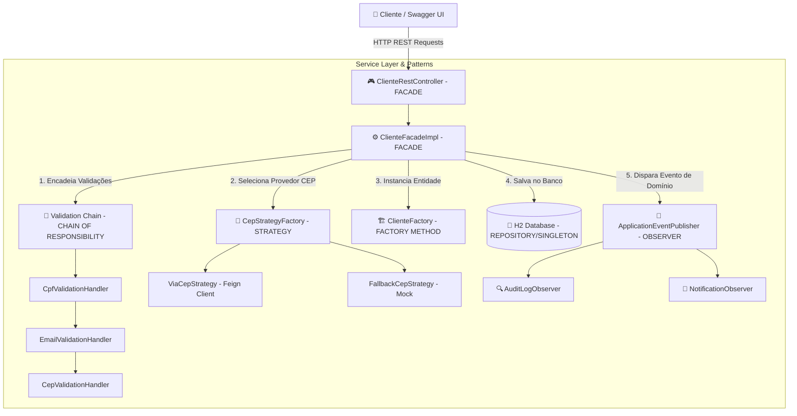

# 🚀 Design Patterns com Java: Dos Clássicos (GoF) ao Spring Framework

[](https://www.oracle.com/java/)
[](https://spring.io/projects/spring-boot)
[](http://localhost:8080/swagger-ui.html)
[](LICENSE)

> **Projeto desenvolvido como Desafio Final do Bootcamp DIO (Digital Innovation One).**
> Evoluído do nível introdutório para uma **Arquitetura de Nível Sênior/Pleno**, demonstrando na prática como os Padrões de Projeto do Gang of Four (GoF) se integram harmoniosamente com o Spring Framework e as melhores práticas do mercado de software.

---

## 📐 Arquitetura do Sistema e Padrões GoF Integrados

A aplicação foi projetada para demonstrar **6 Padrões de Projeto (Design Patterns)** clássicos e modernos trabalhando de forma sinérgica em uma API RESTful completa de gerenciamento de clientes com enriquecimento dinâmico de CEP:



---

## 🛠️ Padrões de Projeto Aplicados

### 1. 🏢 Singleton (Spring IoC Container)
- **Como foi aplicado:** Todos os serviços, controllers, repositories e estratégias são gerenciados como **Singletons** gerenciados pelo Container de Inversão de Controle (IoC) do Spring através das anotações `@Service`, `@Component`, `@Repository` e `@RestController`.

### 2. 🧩 Strategy (Estratégias Dinâmicas de Consulta de CEP)
- **Como foi aplicado:** A interface `CepStrategy` permite trocar em tempo de execução o algoritmo/provedor de resolução de CEP.
- **Implementações:**
  - `ViaCepStrategy`: Integração em tempo real com a API do ViaCEP via Spring Cloud OpenFeign.
  - `FallbackCepStrategy`: Provedor resiliente/mock ativado para contingência ou testes automatizados.
- **Diferencial Sênior:** Uso de `Map<String, CepStrategy>` com a `CepStrategyFactory` para injeção automática e resolução dinâmica com base na requisição do cliente.

### 3. 🔗 Chain of Responsibility (Pipeline de Validação Encadeada)
- **Como foi aplicado:** A classe abstrata `ClienteValidationHandler` permite encadear múltiplas etapas de validação antes de processar qualquer alteração de estado.
- **Cadeia:** `CpfValidationHandler` $\rightarrow$ `EmailValidationHandler` $\rightarrow$ `CepValidationHandler`.
- **Vantagem:** Desacoplamento total das regras de validação. Novas regras podem ser adicionadas na corrente sem alterar o código existente (Open/Closed Principle).

### 4. 🎭 Facade (Interface Simplificada)
- **Como foi aplicado:** A `ClienteFacade` (e o `ClienteRestController`) abstrai a complexidade do subsistema interno (banco de dados H2, APIs externas, cadeia de validação e disparo de eventos) apresentando uma interface unificada e amigável.

### 5. 📢 Observer (Event-Driven Domain Events)
- **Como foi aplicado:** Disparo do evento `ClienteCriadoEvent` via Spring `ApplicationEventPublisher`.
- **Ouvintes (`@EventListener`):**
  - `AuditLogObserver`: Registra a trilha de auditoria em log estruturado.
  - `NotificationObserver`: Simula o envio de e-mail de boas-vindas.

### 6. 🏗️ Factory Method (Criação de Entidades)
- **Como foi aplicado:** A `ClienteFactory` centraliza a criação e configuração inicial das instâncias da entidade `Cliente` com base no `TipoCliente` (`PESSOA_FISICA` vs `PESSOA_JURIDICA`), aplicando formatações e regras específicas.

---

## 🏛️ Boas Práticas e Engenharia de Software

- **DTO Pattern (Data Transfer Object):** Separação estrita entre a camada de apresentação (`ClienteRequestDTO`, `ClienteResponseDTO`) e a camada de persistência (`Cliente`, `Endereco`).
- **JSR-380 Bean Validation:** Validação declarativa com `@NotBlank`, `@Email`, `@Pattern`, `@NotNull`.
- **Tratamento Global de Exceções (`GlobalExceptionHandler`):** Respostas HTTP padronizadas (RFC 7807) para `ResourceNotFoundException`, `ValidationException` (400 Bad Request) e `BusinessException` (409 Conflict).
- **Documentação Interativa com Swagger/OpenAPI:** Documentação rica com `@Operation`, `@ApiResponse` e schemas detalhados.
- **Testes Unitários e de Integração:** Cobertura de testes com JUnit 5, Mockito e MockMvc.

---

## 📋 Endpoints da API

| Método | Endpoint | Descrição | Status HTTP |
| :--- | :--- | :--- | :--- |
| `GET` | `/api/v1/clientes` | Lista todos os clientes cadastrados | `200 OK` |
| `GET` | `/api/v1/clientes/{id}` | Busca os dados de um cliente por ID | `200 OK` / `404 Not Found` |
| `POST` | `/api/v1/clientes` | Cadastra um novo cliente com validação e CEP | `201 Created` / `400 Bad Request` |
| `PUT` | `/api/v1/clientes/{id}` | Atualiza os dados de um cliente existente | `200 OK` / `400 Bad Request` |
| `DELETE` | `/api/v1/clientes/{id}` | Remove um cliente pelo ID | `204 No Content` / `404 Not Found` |

---

## 🚀 Como Executar o Projeto

### Pré-requisitos
- **Java 11** ou superior instalado (`java -version`).
- **Maven Wrapper** incluído no projeto.

### Passos
1. Clone este repositório:
   ```bash
   git clone https://github.com/seu-usuario/lab-padroes-projeto-spring.git
   cd lab-padroes-projeto-spring
   ```

2. Execute os testes unitários e de integração:
   ```bash
   ./mvnw test   # Linux/macOS
   .\mvnw.cmd test # Windows
   ```

3. Inicie a aplicação:
   ```bash
   ./mvnw spring-boot:run   # Linux/macOS
   .\mvnw.cmd spring-boot:run # Windows
   ```

4. Acesse a documentação interativa no navegador:
   - **Swagger UI:** `http://localhost:8080/swagger-ui.html`
   - **H2 Console:** `http://localhost:8080/h2-console`
     - JDBC URL: `jdbc:h2:mem:padroesdb`
     - User: `sa` | Password: *(em branco)*

---

## 💡 Exemplo de Requisição (POST `/api/v1/clientes`)

```json
{
  "nome": "Guilherme Ramos",
  "cpf": "52998224725",
  "email": "guilherme.ramos@email.com",
  "tipoCliente": "PESSOA_FISICA",
  "cep": "01001-000",
  "cepStrategy": "viaCep"
}
```

---

## 👨‍💻 Autor

Desenvolvido para o desafio **Design Patterns com Java** da **DIO (Digital Innovation One)**.
